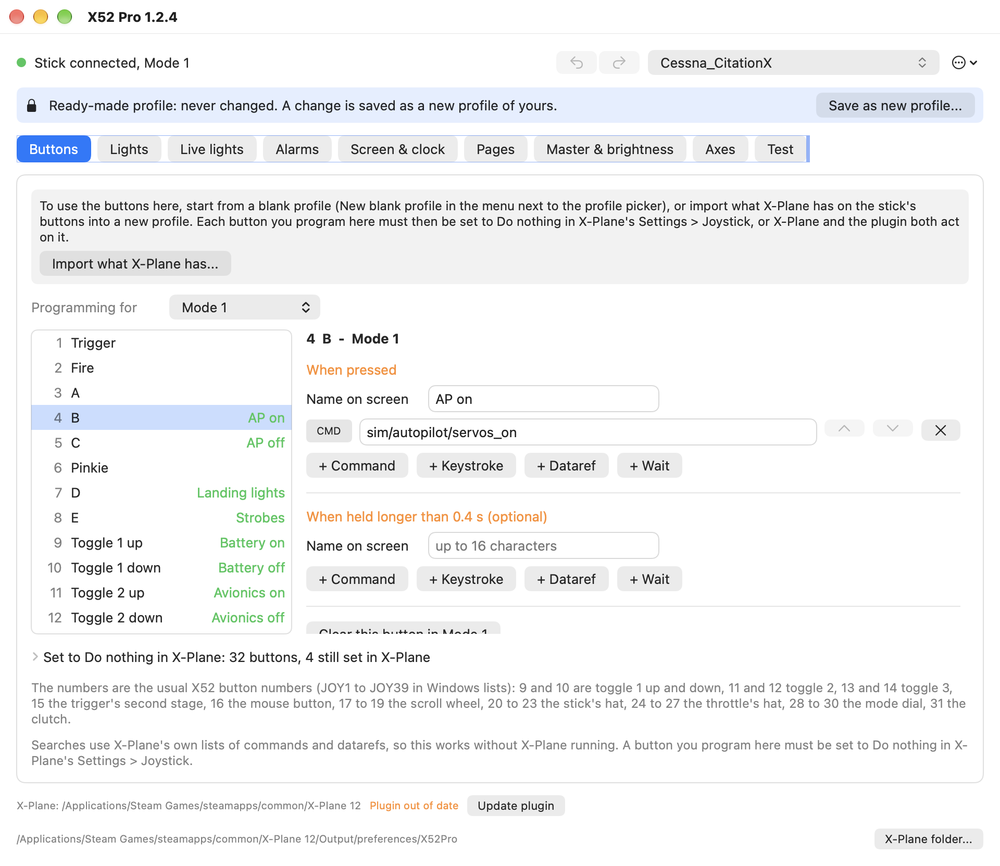
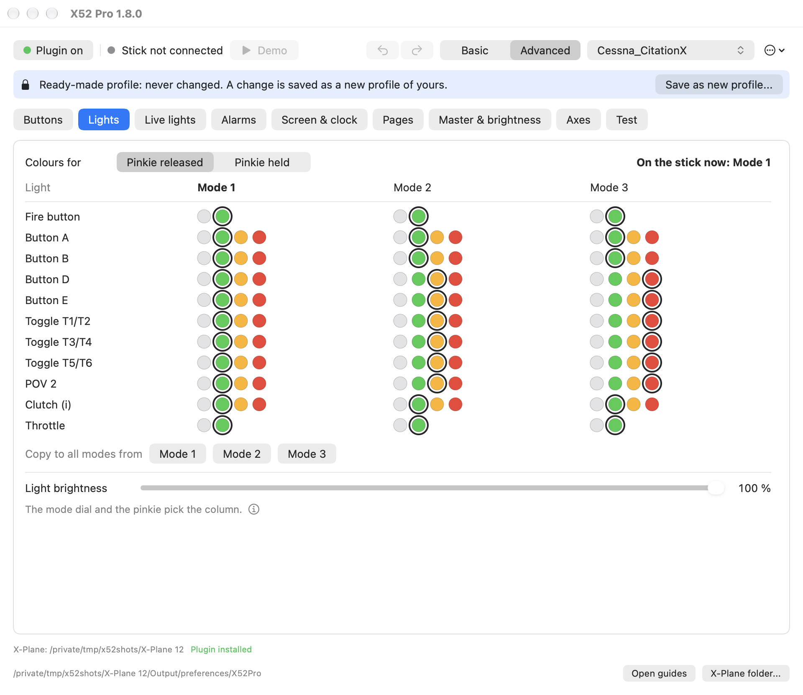
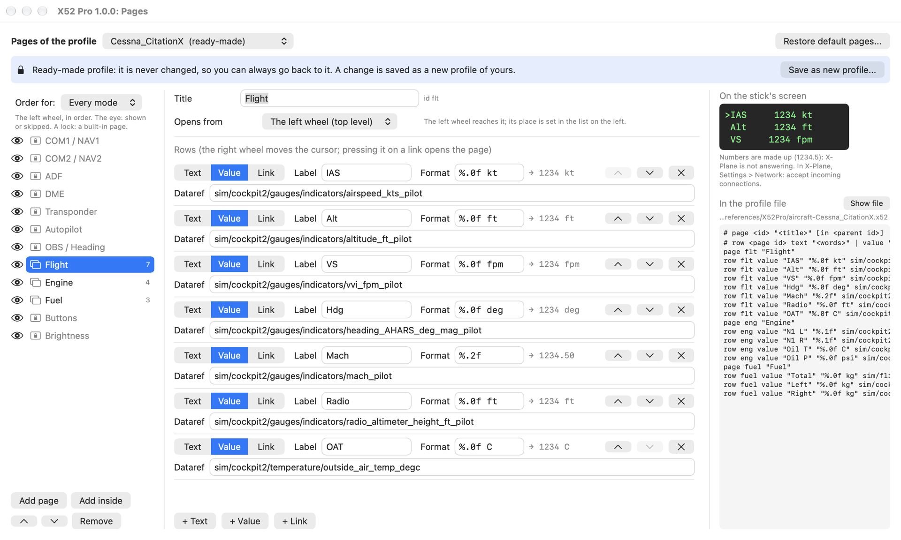

# X52 Pro

### Your joystick. Finally on your Mac.

The Saitek / Logitech X52 and X52 Pro, fully alive in X-Plane 12. 
Free. Open source. Three minutes to install.

Apple Silicon · macOS 13 or newer · X-Plane 12

 

 

## Every button. Six jobs.

Three modes. One pinkie shift. Takeoff, cruise, landing: the stick knows where you are in the flight.

## Fly. Don't set up.

A ready-made profile for every aircraft that comes with X-Plane 12. Pick one. Go.

## Lights that tell the truth.

Parking brake. Gear. Stall. Fire. The stick's lights follow your aircraft.

## A cockpit on the throttle.

Radios. Autopilot. Heading. The little screen becomes your panel, tuned with two wheels.

## One press. Many actions.

Macros, tap and hold, any X-Plane command. Make the stick yours.

## Every aircraft. Documented.

Each ready-made profile comes with a printable button map and a full [guide](profiles/README.md): what every button does, in every mode.

Want it your way? Start a new profile from any of them, change what you like, and keep it as your own **Signature Blueprint**. The originals never change, so you can always go back.

Need a map of your own profile? **Export manual...** (in the menu next to the profile picker) fills a Word file with your buttons, lights, alarms and screen pages. Prefer another layout? Make your own template in Word: [how](docs/custom-manual-template.md).

 

## Install

1. **[Download](https://github.com/sbarrak/X52-HOTAS-for-Mac/releases/latest)** the zip. Unzip it. Drag **X52 Pro** to **Applications**.
2. Open it (the first time, right-click, then **Open**). Press **Install plugin**.
3. Restart X-Plane. **Done.**

Tip: set the buttons you program to *Do nothing* in X-Plane's Settings > Joystick.

 

**Want to know everything it can do?** 
[Read the details →](DETAILS.md)

[Manual](docs/manual/X52-Pro-Manual.docx) · [Profiles](profiles/README.md) · [Changelog](CHANGELOG.md) · [Report a bug](https://github.com/sbarrak/X52-HOTAS-for-Mac/issues) · [Donate](https://paypal.me/sbarrak)

MIT License. Not affiliated with Laminar Research, Logitech or Saitek. X-Plane is a trademark of Laminar Research; Logitech, Saitek and X52 are trademarks of Logitech International S.A.

#x52 #x52pro #xplane #xplane12 #hotas #saitek #logitech #joystick #flightsim #macos #applesilicon

